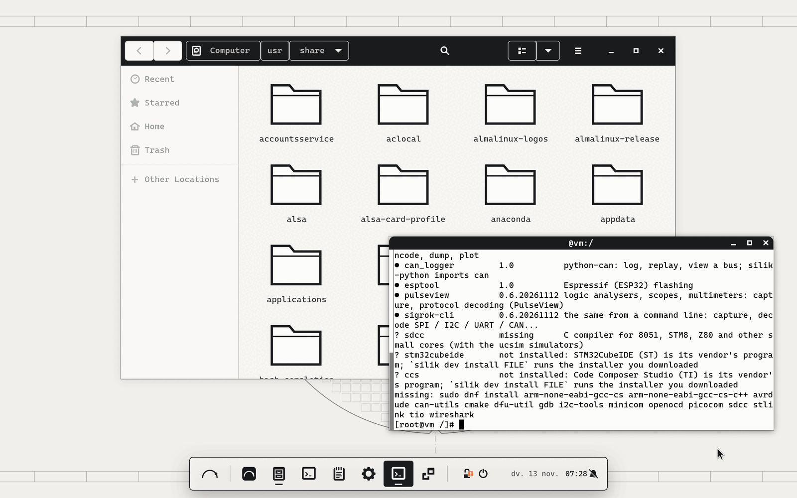
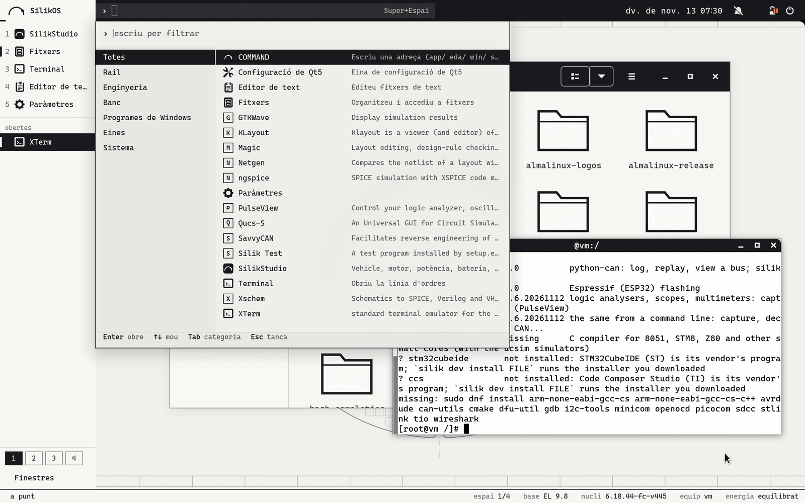
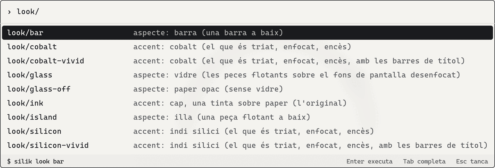
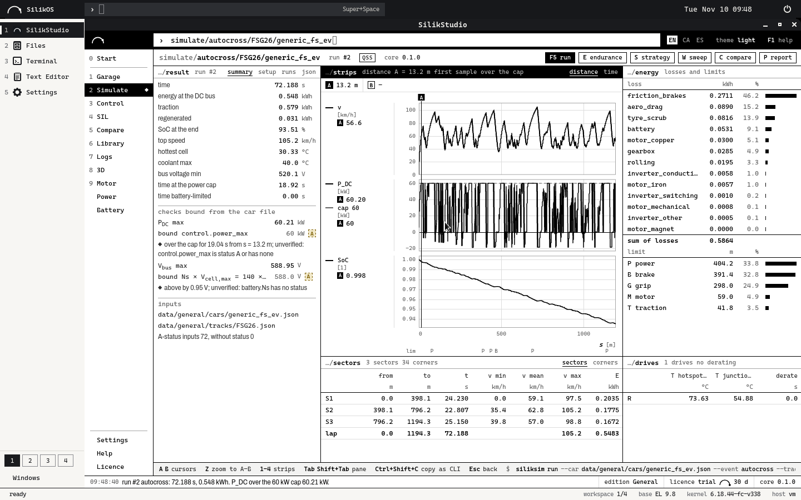

<picture><source media="(prefers-color-scheme: dark)" srcset="packages/silikos-branding/files/silikos-mark-light.svg"></picture>

# SilikOS (de SilikVolt)

[](https://github.com/BTomeu/SilikOs/actions/workflows/ci.yml)

[English](README.md) · Català · [Español](README.es.md)

SilikOS és un sistema per a l'estació de treball d'enginyeria electrònica: una base Enterprise Linux 9 (els paquets i
el nucli d'AlmaLinux, sense tocar, perquè un programa fet per a Red Hat Enterprise Linux 9 hi trobi el sistema que
espera), amb l'escriptori de SilikVolt, les eines obertes de xips, de microcontroladors i de banc, i una capa per als
programes de Windows, tot com a paquets a sobre.

És un prototip verificat en màquines virtuals i contenidors: [`docs/STATUS.md`](docs/STATUS.md) diu què s'ha executat
i què no.









Les tres primeres: el banc de proves de l'escriptori el 13/11/2026 (GNOME Shell 40 en un contenidor AlmaLinux 9.8,
dibuixat sense targeta gràfica, sessió en català; la tercera està retallada al plafó). La quarta: una sessió dins
d'un contenidor el 10/11/2026. Les imatges del sistema tal com la CI l'instal·la en una màquina virtual: branca
[`ci-results`](../../tree/ci-results).

## Què porta

Cada acció de l'escriptori passa per una sola ordre, `silik`. Ensenya cada ordre que executa, i `--dry-run` les
ensenya i no executa res. El COMMAND bar (Super+Espai) ensenya la mateixa línia abans d'Enter.

| Part | Què és | Ordres |
|---|---|---|
| Base | AlmaLinux 9.8: els seus paquets i el seu nucli, dels seus repositoris, sense tocar. SilikOS porta el número de versió de la base i diu SilikOS a tot arreu on mira una persona; els programes hi continuen llegint un sistema EL9 | `silik status`, `silik identity` |
| Escriptori | GNOME Shell 40 sobre X11 en tres aspectes de la mateixa shell: **illa** (el de per defecte), **barra** i **silik**; una tinta sobre paper, o un accent; un joc de vuit fons de pantalla dibuixats com a fulls d'enginyeria, cadascun clar i fosc; Cascadia Mono; anglès, català, castellà | `silik look`, `silik look --accent`, `silik look --glass`, `silik look --wallpaper` |
| Xips | les eines EDA obertes compilades aquí per a EL 9 des de les fonts dels seus autors (Xschem, ngspice, Qucs-S, Magic, KLayout, Netgen, Yosys, NVC, DEVSIM) i Icarus Verilog, Verilator i GTKWave d'EPEL; capses amb un sistema EL6 / EL7 / EL8 per a versions antigues de les eines dels fabricants | `silik eda tools`, `silik eda try`, `silik eda bench`, `silik eda create` |
| Microcontroladors | el compilador GNU per a ARM amb la seva biblioteca de C, el depurador de la base, OpenOCD, dfu-util, les eines d'ST-LINK, stm32flash, SDCC; l'instal·lador d'STM32CubeIDE o de Code Composer Studio que has baixat | `silik dev tools`, `silik dev try`, `silik dev install FILE`, `silik dev ccache` |
| Banc | CAN amb SocketCAN, SavvyCAN, cantools, python-can, terminals sèrie i RS-485, sigrok i PulseView | `silik dev can`, `silik dev serial` |
| Eines de fabricant, laboratoris | aquest sistema contra el que la pàgina d'un fabricant demana per a la seva eina (39 eines com a dades: Vivado, Quartus, MATLAB, Virtuoso, Synopsys, STM32Cube, J-Link, NI, PCAN, VISA...), i les ordres que arreglen cada fila; aquí no s'ha executat cap instal·lador de fabricant. Un manifest dels paquets i els ajustos d'una màquina, per fer iguals les màquines d'un laboratori | `silik vendor list`, `silik vendor check TOOL`, `silik vendor prepare TOOL`, `silik manifest export`, `silik manifest apply FILE` |
| Windows | un doble clic en un `.exe` l'executa amb Wine (el nostre Wine 11.0 compilat per a EL 9, amb Wine Mono i Wine Gecko) dins d'una capsa que no veu la resta de la carpeta personal; un fitxer que no s'ha executat mai abans es pregunta primer, i pot anar aïllat, amb pantalla i xarxa pròpies; una màquina virtual de Windows per al que Wine no pot executar | `silik win open`, `silik win apps`, `silik win vm` |
| Salut | una sola revisió de l'equip: sistema, seguretat, gràfics, banc, EDA, Windows, xarxa; ok / avís / malament / desconegut i l'ordre que ho arregla; desconegut, mai ok, per al que no pot veure | `silik doctor` |
| Seguretat i actualitzacions | SELinux en mode enforcing (el de la base), una zona del tallafoc que descarta les connexions entrants, sshd apagat, totes les actualitzacions instal·lades cada dia; el sistema no reinicia mai pel seu compte | `silik secure status`, `silik secure apply`, `silik update`, `silik update --auto` |
| Actualitzacions dels paquets propis | un repositori de paquets propi de SilikOS amb dos canals (stable: el que ha publicat una release; next: cada build que ha passat els tests), cada paquet i les metadades signats; un canal només s'encén en un sistema que té la clau. Construït i provat amb claus d'un sol ús; no publicat: la clau de signatura l'ha de fer el propietari | `silik update channel`, `silik update channel stable` |
| Sense xarxa | una còpia local d'exactament el que necessiten una instal·lació i les seves actualitzacions (1572 paquets, 2,7 GB), amb la signatura de cada paquet comprovada en entrar; es porta en un USB amb deltes setmanals petits, se serveix, i cada màquina s'hi apunta; un instal·lador que porta el mirall i el comprova abans d'instal·lar. Executat en contenidors i en una màquina emulada amb un conjunt reduït; la ISO completa no s'ha instal·lat | `silik mirror create DIR`, `silik mirror update DIR`, `silik mirror use URL`, `silik mirror status` |
| Energia | rendiment, equilibrat, estalvi o automàtic (rendiment endollat, equilibrat amb bateria), amb el tuned de la base; per a un portàtil: què gasta i què té la bateria tal com ho diu el nucli, una taula dels ajustos que decideixen el consum, el límit de càrrega de la bateria, i un perfil d'estalvi propi de SilikOS sobre el de la base (no ve activat); s'ofereix swap zram; trim de l'SSD cada setmana. No s'ha mesurat cap watt: no s'ha executat en cap portàtil | `silik power`, `silik power check`, `silik power charge 80`, `silik power profiles silikos` |
| Velocitat | el que la base engega o manté en marxa i una estació de treball d'enginyeria no necessita està apagat des de la primera arrencada (nou elements; res de seguretat, cap paràmetre del nucli, res esborrat), i una ordre ho torna a posar; el sistema mesura la seva pròpia arrencada i memòria. Encara no es diu cap temps d'arrencada: les mesures esperen el CI | `silik speed`, `silik speed apply`, `silik speed undo`, `silik bench system` |
| SilikStudio | la suite de SilikVolt com a aplicació nativa: una finestra pròpia, la primera tecla del rail. El seu paquet es construeix des del repositori de SilikStudio | |

## Per a qui és

- Enginyers d'electrònica i de disseny de xips que necessiten una estació EL 9 per a les eines EDA i un escriptori per
  a la resta.
- Laboratoris d'universitat: el flux obert (esquema, simulació, layout, LVS, síntesi) instal·lat, i provat amb una
  ordre.
- Equips de Formula Student i altres equips de sistemes encastats: compilador, depurador, programació, CAN i sèrie en
  un sol sistema.

## Estat

Un prototip verificat en màquines virtuals i contenidors, no un producte. No s'ha executat, entre d'altres: cap
maquinari real (controladors gràfics, Wi-Fi, suspensió, adaptadors CAN, programar una placa), cap eina de fabricant
(Cadence, Synopsys, Altium, STM32CubeIDE), la màquina virtual de Windows, SilikOS instal·lat en una màquina ARM (els paquets i les eines es
construeixen i es proven als runners ARM de GitHub). El repositori d'on un sistema
instal·lat actualitzaria els paquets de SilikOS està construït però no publicat (`docs/REPO.md`): la clau de
signatura l'ha de fer el propietari, de manera que un sistema instal·lat encara no en rep versions noves.
`docs/STATUS.md` té les dues taules, verificat i no verificat, amb com s'ha executat cada fila.

Provat instal·lant-lo: el workflow CI construeix la ISO, la instal·la sola en una màquina virtual, arrenca el sistema
instal·lat i deixa que es revisi ell mateix; l'informe i les imatges són a la branca
[`ci-results`](../../tree/ci-results). L'última execució completa quan es va escriure això és la 43464588417 del
13/11/2026 (commit f14e5cd): 121 comprovacions correctes, cap de fallada, 15 GB de disc; el sistema instal·lat hi va
arrencar en 11,3 a 12,0 s (9,3 s a l'execució anterior: depèn del runner) amb uns 985 MB en ús (una màquina virtual:
`docs/NUMEROS.md`) i va tornar enrere d'una actualització
en un disc LVM real (`docs/ROLLBACK.md`). Al costat de l'AlmaLinux 9 Workstation de sèrie en una mateixa màquina virtual (workflow
Compare, execució 43446488850) va fer servir de 151 a 166 MB menys de memòria i va arribar a l'escriptori de 0,65 a
0,85 s més tard: la seva sessió és X11, per les eines EDA, i la de la base és Wayland. No arrenca més ràpid que la
seva base. La insígnia de dalt és l'estat de la CI.

## Construir-lo i provar-lo

Encara no hi ha cap ISO per baixar. Per provar SilikOS, construeix l'instal·lador i fes-lo servir primer en una
màquina virtual:

```bash
bash tools/build_rpms.sh          # tots els paquets de packages/ + les metadades del repositori a build/repo (rpmbuild, createrepo_c)
python3 -m unittest discover -s tests
bash tools/build_iso.sh           # la ISO d'instal·lació per xarxa (necessita repo.almalinux.org)
```

[`docs/BUILD.md`](docs/BUILD.md) té els passos i què necessita cadascun. [`docs/PRIMERA-HORA.md`](docs/PRIMERA-HORA.md) és la
primera hora amb una placa, una sonda i un adaptador CAN. També: `docs/PLAN.md` (decisions i fases),
`docs/HARDWARE.md` (Ryzen 7 5800HS + RTX 3050, Snapdragon X, SilikOS a ARM / aarch64), `docs/DRIVERS.md` (per a quin maquinari
té controlador el nucli de la base; `silik hw check`), `docs/EDA.md`, `docs/DEV.md`,
`docs/WINDOWS.md`, `docs/POWER.md`, `docs/CONCEPTE.md` (la idea des de zero). `site/` és un lloc estàtic amb el
mateix contingut (`tools/gen_site.py`; encara no està desplegat).

## Llicència, marca, seguretat

- **Llicència.** La llicència del codi propi de SilikOS (aquest repositori) encara no està triada: fins llavors, tots
  els drets reservats. La base i les eines que construeixen els workflows mantenen les seves llicències (el camp
  `License:` de cada recepta a `eda/`, `dev/` i `wine/`; els fitxers de llicència són dins de cada paquet); Cascadia
  Mono té la SIL Open Font License (`packages/silikos-desktop/files/CascadiaMono-LICENSE.txt`).
- **Marca.** Els noms SilikOS, SilikStudio i SilikVolt i la marca SilikVolt no tenen llicència de reutilització.
- **Seguretat.** Per avisar d'una vulnerabilitat en privat: `SECURITY.md`. Què configura el sistema i per què:
  `docs/SECURITY.md`.
- **Fabricants.** No hi ha programari de cap fabricant ni en aquest repositori ni al sistema: les eines EDA, Windows i
  els programes de Windows són llicències de l'usuari. SilikOS no està afiliat ni avalat per l'AlmaLinux OS
  Foundation, Red Hat, ni els fabricants i projectes de les eines que anomena.
