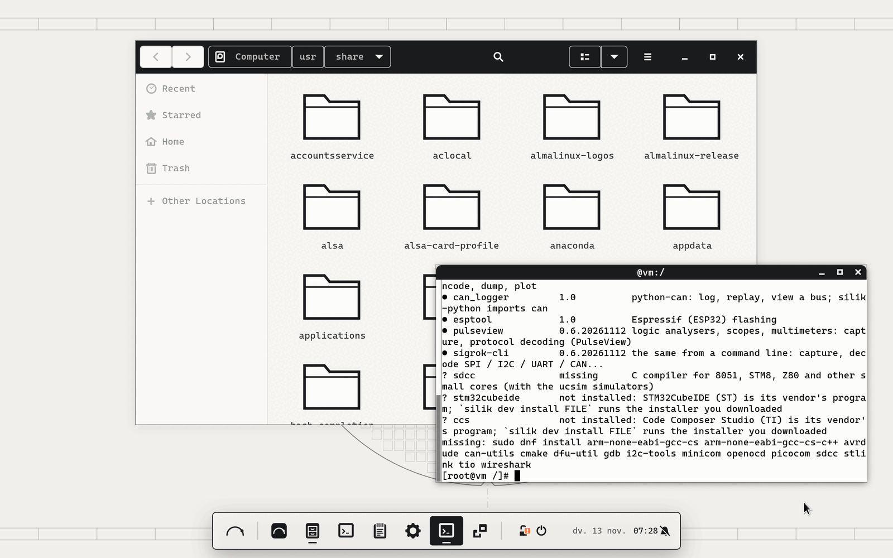
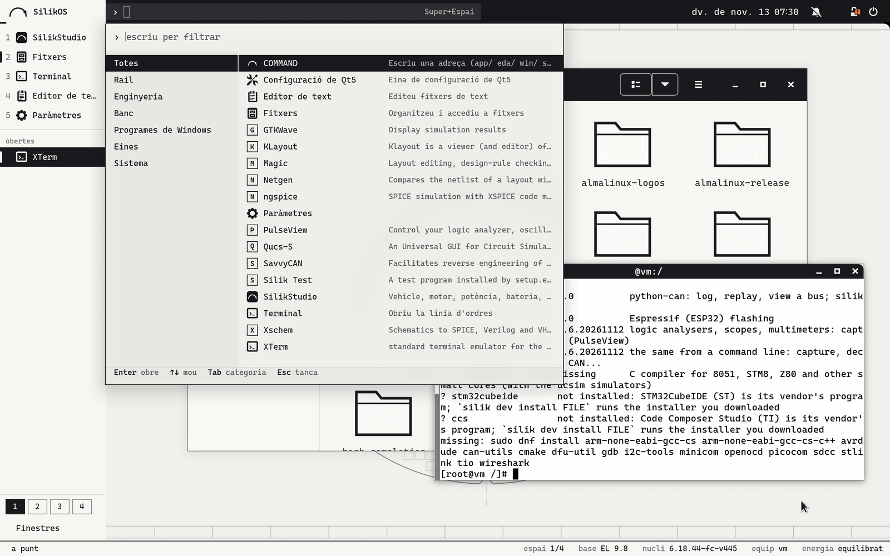
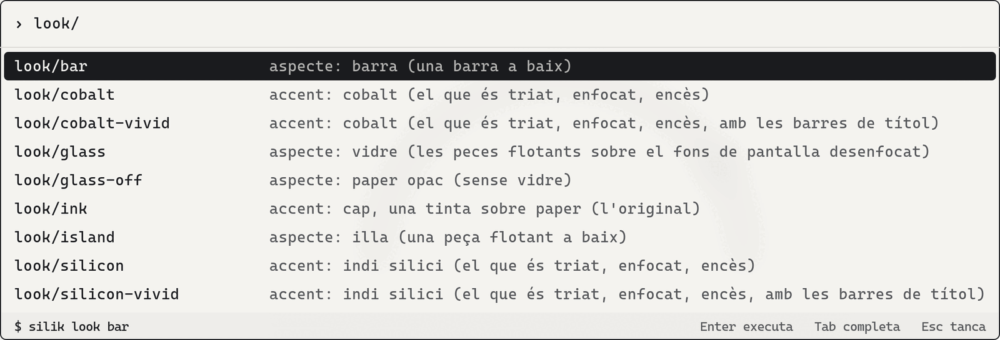
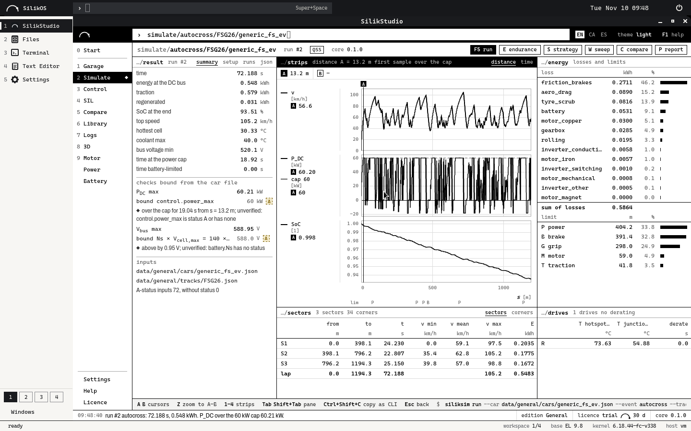

<picture><source media="(prefers-color-scheme: dark)" srcset="packages/silikos-branding/files/silikos-mark-light.svg"></picture>

# SilikOS (de SilikVolt)

[](https://github.com/BTomeu/SilikOs/actions/workflows/ci.yml)

[English](README.md) · [Català](README.ca.md) · Español

SilikOS es un sistema para la estación de trabajo de ingeniería electrónica: una base Enterprise Linux 9 (los
paquetes y el núcleo de AlmaLinux, sin tocar, para que un programa hecho para Red Hat Enterprise Linux 9 encuentre el
sistema que espera), con el escritorio de SilikVolt, las herramientas abiertas de chips, de microcontroladores y de
banco, y una capa para los programas de Windows, todo como paquetes encima.

Es un prototipo verificado en máquinas virtuales y contenedores: [`docs/STATUS.md`](docs/STATUS.md) dice qué se ha
ejecutado y qué no.









Las tres primeras: el banco de pruebas del escritorio el 13/11/2026 (GNOME Shell 40 en un contenedor AlmaLinux 9.8,
dibujado sin tarjeta gráfica, sesión en catalán; la tercera está recortada al panel). La cuarta: una sesión dentro de
un contenedor el 10/11/2026. Las imágenes del sistema tal como la CI lo instala en una máquina virtual: rama
[`ci-results`](../../tree/ci-results).

## Qué trae

Cada acción del escritorio pasa por una sola orden, `silik`. Muestra cada orden que ejecuta, y `--dry-run` las
muestra y no ejecuta nada. El COMMAND bar (Super+Espacio) muestra la misma línea antes de Enter.

| Parte | Qué es | Órdenes |
|---|---|---|
| Base | AlmaLinux 9.8: sus paquetes y su núcleo, de sus repositorios, sin tocar. SilikOS lleva el número de versión de la base y dice SilikOS allí donde mira una persona; los programas siguen leyendo un sistema EL9 | `silik status`, `silik identity` |
| Escritorio | GNOME Shell 40 sobre X11 en tres aspectos de la misma shell: **isla** (el de por defecto), **barra** y **silik**; una tinta sobre papel, o un acento; Cascadia Mono; inglés, catalán, castellano | `silik look`, `silik look --accent`, `silik look --glass` |
| Chips | las herramientas EDA abiertas compiladas aquí para EL 9 desde las fuentes de sus autores (Xschem, ngspice, Qucs-S, Magic, KLayout, Netgen, Yosys, NVC, DEVSIM) e Icarus Verilog, Verilator y GTKWave de EPEL; cajas con un sistema EL6 / EL7 / EL8 para versiones antiguas de las herramientas de los fabricantes | `silik eda tools`, `silik eda try`, `silik eda bench`, `silik eda create` |
| Microcontroladores | el compilador GNU para ARM con su biblioteca de C, el depurador de la base, OpenOCD, dfu-util, las herramientas de ST-LINK, stm32flash, SDCC; el instalador de STM32CubeIDE o de Code Composer Studio que has descargado | `silik dev tools`, `silik dev try`, `silik dev install FILE`, `silik dev ccache` |
| Banco | CAN con SocketCAN, SavvyCAN, cantools, python-can, terminales serie y RS-485, sigrok y PulseView | `silik dev can`, `silik dev serial` |
| Herramientas de fabricante, laboratorios | este sistema contra lo que la página de un fabricante pide para su herramienta (39 herramientas como datos: Vivado, Quartus, MATLAB, Virtuoso, Synopsys, STM32Cube, J-Link, NI, PCAN, VISA...), y las órdenes que arreglan cada fila; aquí no se ha ejecutado ningún instalador de fabricante. Un manifiesto de los paquetes y los ajustes de una máquina, para hacer iguales las máquinas de un laboratorio | `silik vendor list`, `silik vendor check TOOL`, `silik vendor prepare TOOL`, `silik manifest export`, `silik manifest apply FILE` |
| Windows | un doble clic en un `.exe` lo ejecuta con Wine (nuestro Wine 11.0 compilado para EL 9, con Wine Mono y Wine Gecko) dentro de una caja que no ve el resto de la carpeta personal; una máquina virtual de Windows para lo que Wine no puede ejecutar | `silik win open`, `silik win apps`, `silik win vm` |
| Salud | una sola revisión del equipo: sistema, seguridad, gráficos, banco, EDA, Windows, red; ok / aviso / mal / desconocido y la orden que lo arregla; desconocido, nunca ok, para lo que no puede ver | `silik doctor` |
| Seguridad y actualizaciones | SELinux en modo enforcing (el de la base), una zona del cortafuegos que descarta las conexiones entrantes, sshd apagado, todas las actualizaciones instaladas cada día; el sistema nunca reinicia por su cuenta | `silik secure status`, `silik secure apply`, `silik update`, `silik update --auto` |
| Actualizaciones de los paquetes propios | un repositorio de paquetes propio de SilikOS con dos canales (stable: lo que ha publicado una release; next: cada build que ha pasado los tests), cada paquete y los metadatos firmados; un canal solo se enciende en un sistema que tiene la clave. Construido y probado con claves de un solo uso; no publicado: la clave de firma la tiene que hacer el propietario | `silik update channel`, `silik update channel stable` |
| Sin red | una copia local de exactamente lo que necesitan una instalación y sus actualizaciones (1572 paquetes, 2,7 GB), con la firma de cada paquete comprobada al entrar; se lleva en un USB con deltas semanales pequeños, se sirve, y cada máquina apunta a ella; un instalador que lleva el espejo y lo comprueba antes de instalar. Ejecutado en contenedores y en una máquina emulada con un conjunto reducido; la ISO completa no se ha instalado | `silik mirror create DIR`, `silik mirror update DIR`, `silik mirror use URL`, `silik mirror status` |
| Energía | rendimiento, equilibrado, ahorro o automático (rendimiento enchufado, equilibrado con batería), con el tuned de la base; se ofrece swap zram; trim del SSD cada semana | `silik power` |
| Velocidad | lo que la base arranca o mantiene en marcha y una estación de trabajo de ingeniería no necesita está apagado desde el primer arranque (nueve elementos; nada de seguridad, ningún parámetro del núcleo, nada borrado), y una orden lo vuelve a poner; el sistema mide su propio arranque y memoria. Aún no se dice ningún tiempo de arranque: las medidas esperan al CI | `silik speed`, `silik speed apply`, `silik speed undo`, `silik bench system` |
| SilikStudio | la suite de SilikVolt como aplicación nativa: una ventana propia, la primera tecla del rail. Su paquete se construye desde el repositorio de SilikStudio | |

## Para quién es

- Ingenieros de electrónica y de diseño de chips que necesitan una estación EL 9 para las herramientas EDA y un
  escritorio para lo demás.
- Laboratorios de universidad: el flujo abierto (esquema, simulación, layout, LVS, síntesis) instalado, y probado con
  una orden.
- Equipos de Formula Student y otros equipos de sistemas embebidos: compilador, depurador, programación, CAN y serie
  en un solo sistema.

## Estado

Un prototipo verificado en máquinas virtuales y contenedores, no un producto. No se ha ejecutado, entre otros: ningún
hardware real (controladores gráficos, Wi-Fi, suspensión, adaptadores CAN, programar una placa), ninguna herramienta
de fabricante (Cadence, Synopsys, Altium, STM32CubeIDE), la máquina virtual de Windows, ARM si no es emulado. El repositorio del que un
sistema instalado actualizaría los paquetes de SilikOS está construido pero no publicado (`docs/REPO.md`): la clave
de firma la tiene que hacer el propietario, así que un sistema instalado todavía no recibe versiones nuevas. `docs/STATUS.md` tiene las dos tablas, verificado y no verificado, con cómo se ha ejecutado cada fila.

Probado instalándolo: el workflow CI construye la ISO, la instala sola en una máquina virtual, arranca el sistema
instalado y deja que se revise a sí mismo; el informe y las imágenes están en la rama
[`ci-results`](../../tree/ci-results). La última ejecución completa cuando se escribió esto (13/11/2026) es la del
commit fa6c6e8 (11/11/2026, 86 comprobaciones correctas, ninguna fallida); lo que ha cambiado después se ha ejecutado
solo en contenedores. Los workflows se volvieron a poner en marcha el 13/11/2026: la insignia de arriba es el estado
de la CI.

## Construirlo y probarlo

Todavía no hay ninguna ISO para descargar. Para probar SilikOS, construye el instalador y úsalo primero en una
máquina virtual:

```bash
bash tools/build_rpms.sh          # todos los paquetes de packages/ + los metadatos del repositorio en build/repo (rpmbuild, createrepo_c)
python3 -m unittest discover -s tests
bash tools/build_iso.sh           # la ISO de instalación por red (necesita repo.almalinux.org)
```

[`docs/BUILD.md`](docs/BUILD.md) tiene los pasos y qué necesita cada uno. [`docs/PRIMERA-HORA.md`](docs/PRIMERA-HORA.md) es la
primera hora con una placa, una sonda y un adaptador CAN (en catalán). También: `docs/PLAN.md` (decisiones y
fases), `docs/HARDWARE.md` (Ryzen 7 5800HS + RTX 3050, Snapdragon X, SilikOS en ARM / aarch64), `docs/DRIVERS.md` (para qué hardware
tiene controlador el núcleo de la base; `silik hw check`), `docs/EDA.md`,
`docs/DEV.md`, `docs/WINDOWS.md`, `docs/POWER.md`, `docs/CONCEPTE.md` (la idea desde cero, en catalán). `site/` es un
sitio estático con el mismo contenido (`tools/gen_site.py`; todavía no está desplegado).

## Licencia, marca, seguridad

- **Licencia.** La licencia del código propio de SilikOS (este repositorio) todavía no está elegida: hasta entonces,
  todos los derechos reservados. La base y las herramientas que construyen los workflows mantienen sus licencias (el
  campo `License:` de cada receta en `eda/`, `dev/` y `wine/`; los archivos de licencia están dentro de cada
  paquete); Cascadia Mono tiene la SIL Open Font License (`packages/silikos-desktop/files/CascadiaMono-LICENSE.txt`).
- **Marca.** Los nombres SilikOS, SilikStudio y SilikVolt y la marca SilikVolt no tienen licencia de reutilización.
- **Seguridad.** Para avisar de una vulnerabilidad en privado: `SECURITY.md`. Qué configura el sistema y por qué:
  `docs/SECURITY.md`.
- **Fabricantes.** No hay software de ningún fabricante ni en este repositorio ni en el sistema: las herramientas
  EDA, Windows y los programas de Windows son licencias del usuario. SilikOS no está afiliado ni avalado por la
  AlmaLinux OS Foundation, Red Hat, ni los fabricantes y proyectos de las herramientas que nombra.
