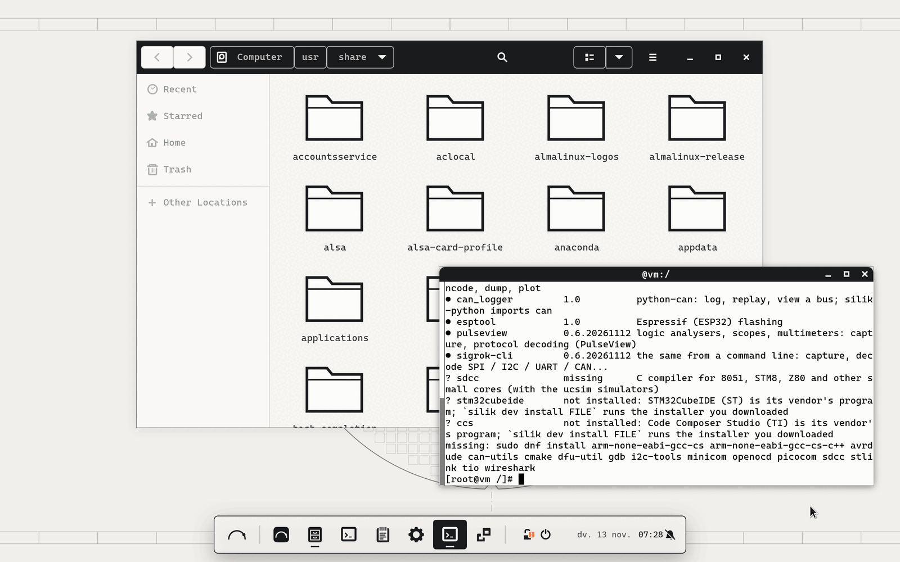
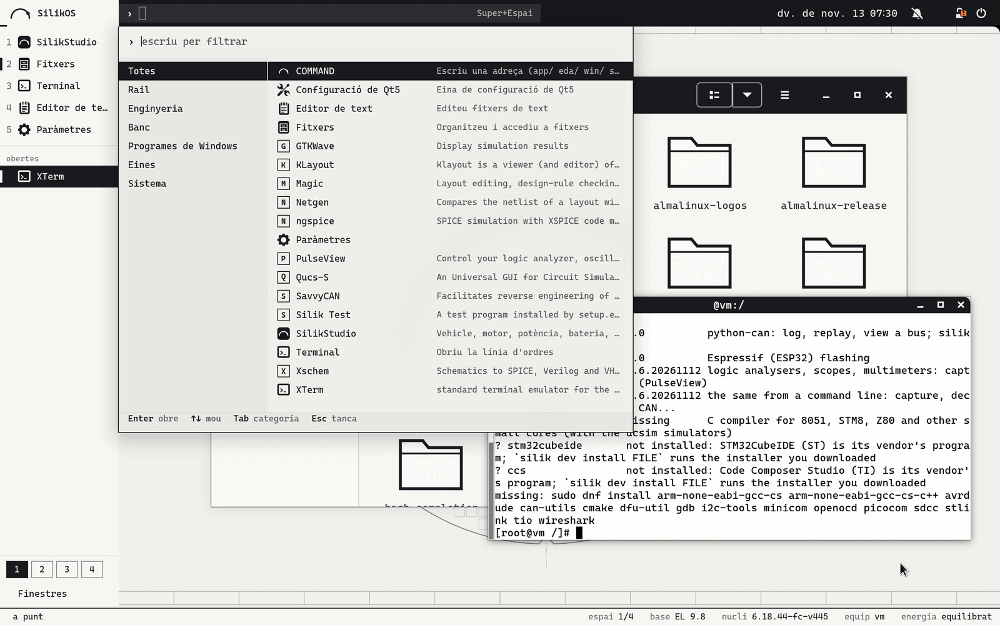
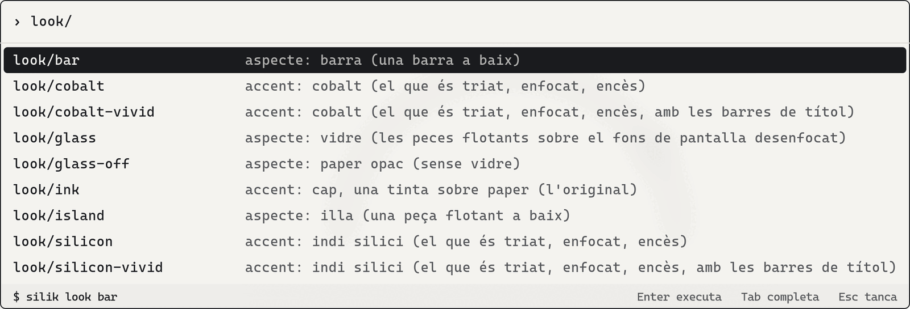

<picture><source media="(prefers-color-scheme: dark)" srcset="packages/silikos-branding/files/silikos-mark-light.svg"></picture>

# SilikOS (by SilikVolt)

[](https://github.com/BTomeu/SilikOs/actions/workflows/ci.yml)

English · [Català](README.ca.md) · [Español](README.es.md)

SilikOS is an engineering workstation system for electronics: an Enterprise Linux 9 base (AlmaLinux's packages and
kernel, unchanged, so that a program written for Red Hat Enterprise Linux 9 finds the system it expects), with the
SilikVolt desktop, the open chip, embedded and bench tools and a layer for Windows programs as packages on top.

It is a prototype verified in virtual machines and containers: [`docs/STATUS.md`](docs/STATUS.md) says what has
been run and what has not.








The first three: the desktop test rig on 13/11/2026 (GNOME Shell 40 in an AlmaLinux 9.8 container, drawn without a
graphics card, session in Catalan; the third is cut to the pane). The fourth: a container session on 10/11/2026.
Pictures of the system as the CI installs it in a virtual machine: branch [`ci-results`](../../tree/ci-results).

## What you get

Every action of the desktop goes through one command, `silik`. It prints each command it runs, and `--dry-run`
prints them and runs nothing. The COMMAND bar (Super+Space) shows the same line before Enter.

| Part | What it is | Commands |
|---|---|---|
| Base | AlmaLinux 9.8: its packages and kernel from its own repositories, unchanged. SilikOS carries the base's version number and says SilikOS wherever a person looks; programs still read an EL9 system | `silik status`, `silik identity` |
| Desktop | GNOME Shell 40 on X11 in three looks of the same shell: **island** (the default), **bar** and **silik**; one ink on paper, or an accent; a set of eight backgrounds drawn as engineering sheets, each light and dark; Cascadia Mono; English, Catalan, Spanish | `silik look`, `silik look --accent`, `silik look --glass`, `silik look --wallpaper` |
| Chips | the open EDA tools built here for EL 9 from their authors' sources (Xschem, ngspice, Qucs-S, Magic, KLayout, Netgen, Yosys, NVC, DEVSIM) and Icarus Verilog, Verilator, GTKWave from EPEL; boxes with an EL6 / EL7 / EL8 userland for older releases of the vendors' tools | `silik eda tools`, `silik eda try`, `silik eda bench`, `silik eda create` |
| Embedded | the GNU ARM compiler with its C library, the base's debugger, OpenOCD, dfu-util, ST-LINK's tools, stm32flash, SDCC; the installer of STM32CubeIDE or Code Composer Studio that you downloaded | `silik dev tools`, `silik dev try`, `silik dev install FILE`, `silik dev ccache` |
| Bench | CAN through SocketCAN, SavvyCAN, cantools, python-can, serial and RS-485 terminals, sigrok and PulseView | `silik dev can`, `silik dev serial` |
| Vendors' tools, labs | this system against what a vendor's page asks for its tool (39 tools as data: Vivado, Quartus, MATLAB, Virtuoso, Synopsys, STM32Cube, J-Link, NI, PCAN, VISA...), and the commands that fix each row; no vendor's installer has been run here. A manifest of a machine's packages and settings, to make a lab's machines the same | `silik vendor list`, `silik vendor check TOOL`, `silik vendor prepare TOOL`, `silik manifest export`, `silik manifest apply FILE` |
| Windows | a double-click on an `.exe` runs it with Wine (our build of Wine 11.0 for EL 9, with Wine Mono and Wine Gecko) in a sandbox that does not see the rest of the home folder; a Windows virtual machine for what Wine cannot run | `silik win open`, `silik win apps`, `silik win vm` |
| Health | one audit of the workstation: system, security, graphics, bench, EDA, Windows, network; ok / warn / bad / unknown and the command that fixes each; unknown, never ok, for what it cannot see | `silik doctor` |
| Security and updates | SELinux enforcing (the base's), a firewall zone that drops incoming connections, sshd off, every update installed daily; the system never restarts by itself | `silik secure status`, `silik secure apply`, `silik update`, `silik update --auto` |
| Updates of its own packages | a package repository of SilikOS's own with two channels (stable: what a release published; next: every build that passed the tests), every package and the metadata signed; a channel is turned on only on a system that has the key. Built and tried with throw-away keys; not published: the signing key is the owner's to make | `silik update channel`, `silik update channel stable` |
| Without a network | a local copy of exactly what an installation and its updates take (1572 packages, 2.7 GB), each package's signature checked on the way in; carried on a USB stick with small weekly deltas, served, and used by each machine; an installer that carries the mirror and verifies it before installing. Run in containers and in an emulated machine with a reduced set; the full ISO has not been installed | `silik mirror create DIR`, `silik mirror update DIR`, `silik mirror use URL`, `silik mirror status` |
| Power | performance, balanced, saver, or auto (performance on mains power, balanced on battery), through the base's tuned; zram swap offered, SSD trim weekly | `silik power` |
| Speed | what the base starts or keeps running and an engineer's workstation does not need is off from the first start (nine items; nothing of security, no kernel parameter, nothing removed), and one command puts each back; the system measures its own start and memory. No start time is claimed yet: the measurements wait for the CI | `silik speed`, `silik speed apply`, `silik speed undo`, `silik bench system` |
| SilikStudio | the SilikVolt suite as a native application: a window of its own, the first key of the rail. Its package is built from SilikStudio's repository | |

## Who it is for

- Electronics and chip-design engineers who need an EL 9 workstation for the EDA tools and a desktop for the rest.
- University labs: the open flow (schematic, simulation, layout, LVS, synthesis) installed, and tried by one command.
- Formula Student and other embedded teams: compiler, debugger, flashing, CAN and serial on one system.

## State

A prototype verified in virtual machines and containers, not a product. Not run, among others: any real hardware
(graphics drivers, Wi-Fi, suspend, CAN adapters, flashing a board), any vendor tool (Cadence, Synopsys, Altium,
STM32CubeIDE), the Windows virtual machine, SilikOS installed on an ARM machine (its packages and tools are built and tried on
GitHub's ARM runners). The repository an installed system would update
SilikOS's own packages from is built but not published (`docs/REPO.md`): its signing key is the owner's to make, so
an installed system does not receive new versions of them yet. `docs/STATUS.md` has both tables, verified
and not verified, with how each row was run.

Tested by installing it: the workflow CI builds the ISO, installs it unattended in a virtual machine, boots the
installed system and lets it check itself; the report and the pictures are on the branch
[`ci-results`](../../tree/ci-results). The last complete run when this was written is run 43464588417 of
13/11/2026 (commit f14e5cd): 121 checks ok, none failed, 15 GB on disk; in it the installed system started in 11.3
to 12.0 s (9.3 s in the run before: it depends on the runner) with about 985 MB in use (a virtual machine:
`docs/NUMEROS.md`), and went back from an update on a real LVM disk
(`docs/ROLLBACK.md`). Beside the stock AlmaLinux 9 Workstation in one virtual machine (workflow Compare, run
43446488850) it used 151 to 166 MB less memory and reached the desktop 0.65 to 0.85 s later: its session is X11, for
the EDA tools, the base's is Wayland. It is not faster to start than its base. The badge above is the CI's state.

## Build and try

There is no ISO to download yet. To try SilikOS, build the installer and use it in a virtual machine first:

```bash
bash tools/build_rpms.sh          # every package of packages/ + repository metadata in build/repo (rpmbuild, createrepo_c)
python3 -m unittest discover -s tests
bash tools/build_iso.sh           # the network installer ISO (needs repo.almalinux.org)
```

[`docs/BUILD.md`](docs/BUILD.md) has the steps and what each needs. [`docs/PRIMERA-HORA.md`](docs/PRIMERA-HORA.md) is the
first hour with a board, a probe and a CAN adapter (in Catalan). Also: `docs/PLAN.md` (decisions and phases),
`docs/HARDWARE.md` (Ryzen 7 5800HS + RTX 3050, Snapdragon X), `docs/ARM.md` (SilikOS on ARM / aarch64), `docs/DRIVERS.md` (which hardware the base's
kernel has a driver for; `silik hw check`), `docs/EDA.md`, `docs/DEV.md`,
`docs/WINDOWS.md`, `docs/POWER.md`, `docs/CONCEPTE.md` (the idea from zero, in Catalan). `site/` is a static site
with the same content (`tools/gen_site.py`; not deployed yet).

## Licence, brand, security

- **Licence.** The licence of SilikOS's own code (this repository) is not chosen yet: until it is, all rights are
  reserved. The base and the tools the workflows build keep their own licences (each recipe's `License:` field in
  `eda/`, `dev/` and `wine/`; the licence files are inside each package); Cascadia Mono is under the SIL Open Font
  License (`packages/silikos-desktop/files/CascadiaMono-LICENSE.txt`).
- **Brand.** The names SilikOS, SilikStudio and SilikVolt and the SilikVolt mark are not licensed for reuse.
- **Security.** To report a vulnerability privately: `SECURITY.md`. What the system sets and why: `docs/SECURITY.md`.
- **Vendors.** No vendor software is in this repository or in the system: EDA tools, Windows and Windows programs are
  the user's own licences. SilikOS is not affiliated with or endorsed by the AlmaLinux OS Foundation, Red Hat, or the
  vendors and projects whose tools it names.
