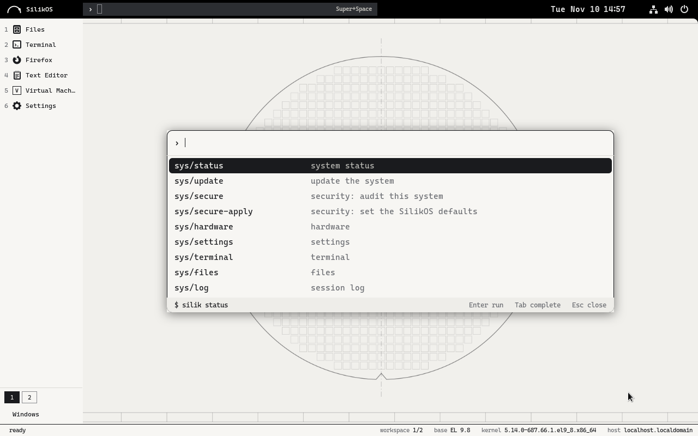
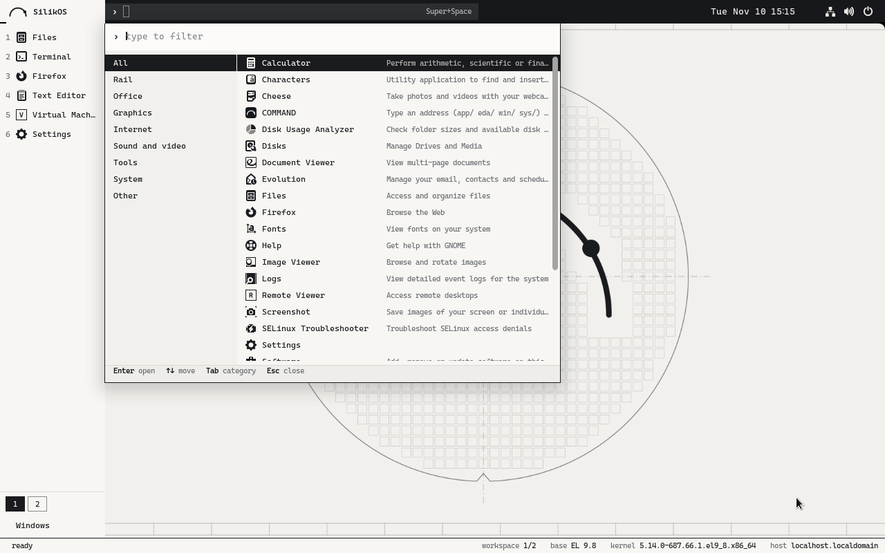
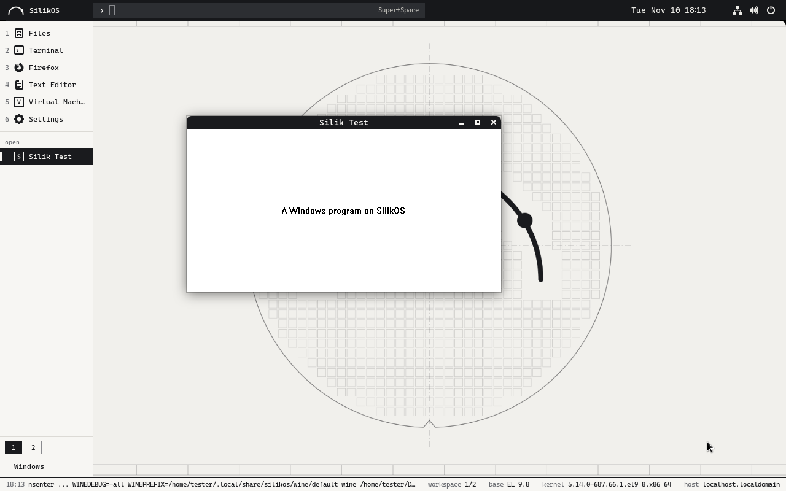
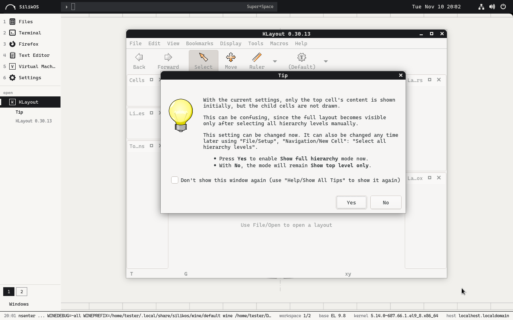
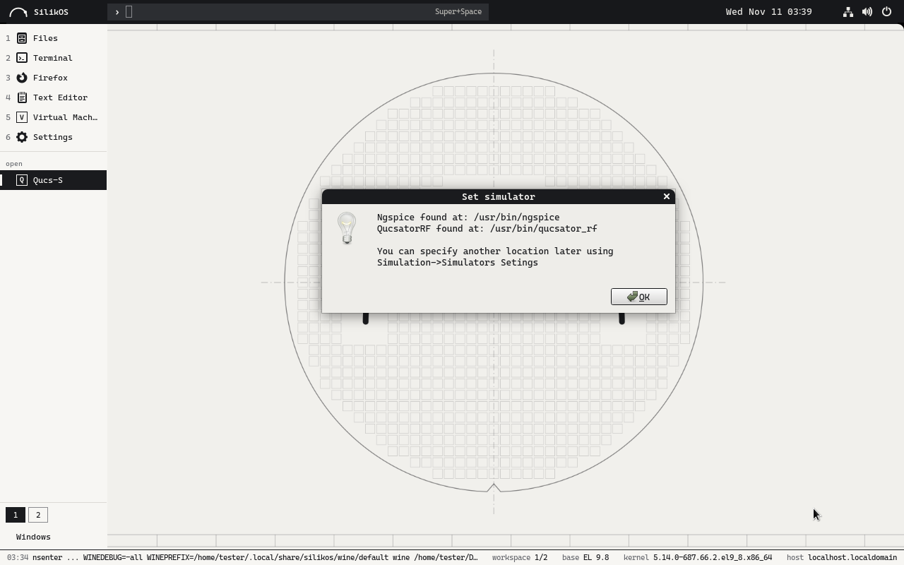
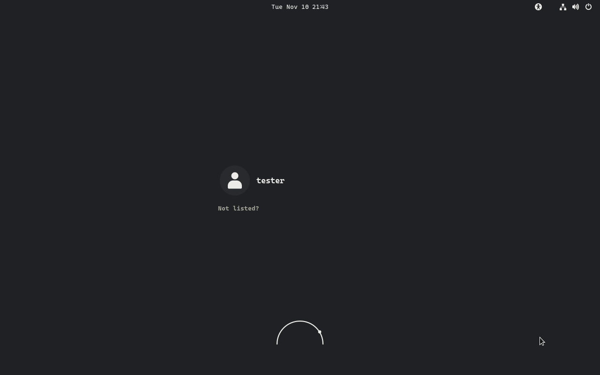
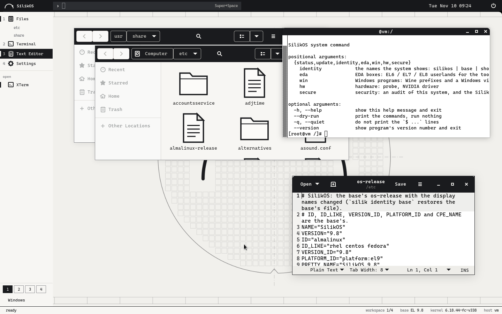
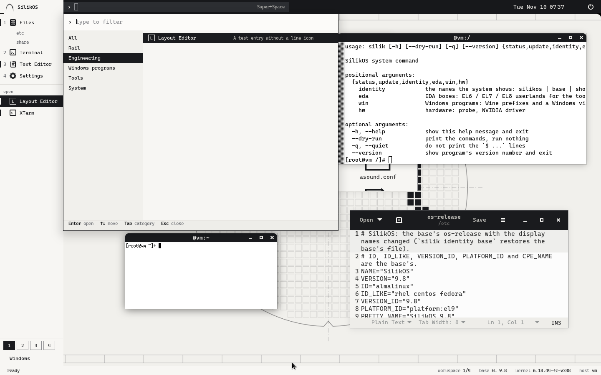
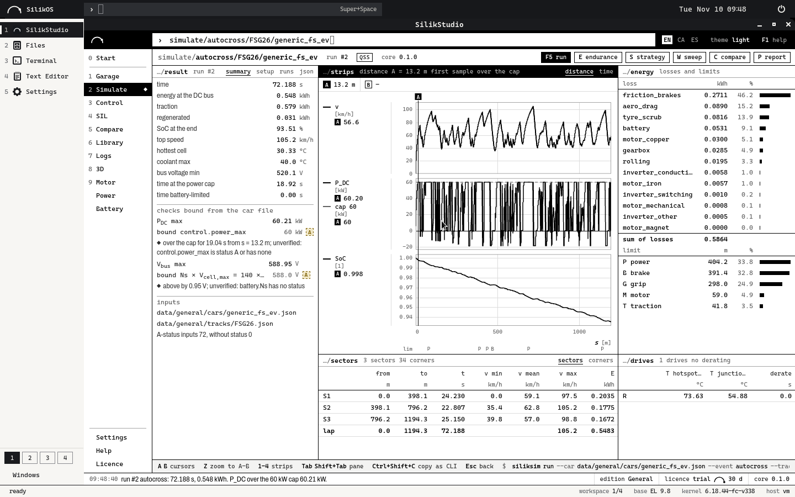

# SilikOS (by SilikVolt)

An engineering workstation system on an Enterprise Linux 9 base (AlmaLinux's packages and kernel, unchanged, so that
EDA tools install and run), with the SilikVolt desktop on top, boxes for older EDA releases, and a layer for Windows
programs. It carries the base's version (SilikOS 9.8) and says SilikOS wherever a person looks; programs still read
an EL9 system. It is a try: `docs/STATUS.md` says what has been run and what has not.

| Part | What it is | Where |
|---|---|---|
| Base | AlmaLinux 9 packages and kernel, from its own repositories | `kickstart/silikos.ks` |
| Desktop | GNOME Shell on X11 in three looks of the same shell (`silik look`): **island** (the default: one floating piece at the bottom), **bar** (one bar at the bottom) and **silik** (command line, text rail, status bar); one ink on paper, or an accent, alone or with coloured title bars (`silik look --accent`); the **COMMAND** bar on Super+Space | `packages/silikos-desktop`, `packages/silik-command` |
| Tested by installing it | every change is built into an ISO, installed unattended in a virtual machine, booted and checked; the last report and pictures of the installed system are on the branch [`ci-results`](../../tree/ci-results) | `.github/workflows/ci.yml`, `tests/install/` |
| Security | SELinux enforcing (the base's), a firewall zone that drops incoming connections, sshd off, daily security-only updates, screen lock; `silik secure status` audits, `silik secure apply` sets; `docs/SECURITY.md` | `packages/silikos-security` |
| SilikStudio | the SilikVolt suite as a native application: a window of its own, the first key of the rail, its programs in the PATH. Its package is built from SilikStudio's repository on EL 9 and put in `build/extra/` for the ISO | `tools/build_iso.sh`, `docs/img/silikstudio.png` |
| `silik` | one command behind every action; prints what it runs; `--dry-run` | `packages/silik-tools` |
| EDA | what Cadence / Synopsys tools ask of EL9, and EL6 / EL7 / EL8 boxes (`silik eda`); the open tools (Xschem, ngspice, Qucs-S, Magic, KLayout, Netgen, Yosys, NVC built here for EL 9 from their authors' sources; Icarus Verilog, Verilator, GTKWave from EPEL), `silik eda try` to see them work together, `silik eda bench` / `tune` for the simulator's speed | `packages/silik-eda-compat`, `packages/silik-eda-open`, `eda/`, `docs/EDA.md` |
| Embedded | the GNU ARM compiler with its C library, the base's debugger, OpenOCD and dfu-util (built here for EL 9), ST-LINK's tools; `silik dev try` makes them do real jobs; `silik dev install FILE` runs the installer of STM32CubeIDE or Code Composer Studio that the user downloaded (their vendors' programs: not on the ISO) | `packages/silik-dev`, `dev/`, `docs/DEV.md` |
| Windows | a double-click on an `.exe` runs it in a sandbox that does not see the rest of the home folder (`silik win open`); installed programs are applications of the desktop; a Windows virtual machine for what Wine cannot run. Wine is our own build for EL 9 (`silik-wine`, Wine 11.0), with Wine Mono and Wine Gecko as packages (.NET and HTML without a download dialog), on the ISO | `packages/silik-win`, `wine/`, `docs/WINDOWS.md` |
| Name and look | os-release display names, boot menu, boot splash, login logo, backgrounds; the installer's screens | `packages/silikos-branding`, `installer/`, `brand/` |















The system as installed by the CI in a virtual machine on 10/11/2026 (a real session; the pictures of the last run: branch `ci-results`).







The desktop as run on 10/11/2026 (GNOME Shell 40.10 in an AlmaLinux 9.8 container, software rendering; see
`docs/STATUS.md` for what has and has not been run). The installer: `docs/img/installer.png`.

```bash
bash tools/build_rpms.sh          # every package of packages/ + repository metadata in build/repo (rpmbuild, createrepo_c)
python3 -m unittest discover -s tests
bash tools/build_iso.sh           # the network installer ISO (needs repo.almalinux.org)
```

Read `docs/PLAN.md` (decisions and phases), `docs/STATUS.md` (verified / not verified), `docs/HARDWARE.md`
(Ryzen 7 5800HS + RTX 3050, Snapdragon X), `docs/BUILD.md`.

No vendor software is in this repository or in the system: EDA tools, Windows and Windows programs are the user's own
licences.
